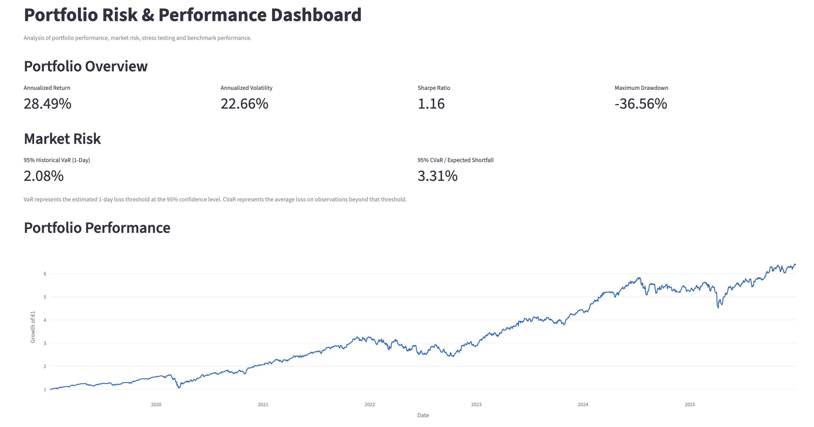
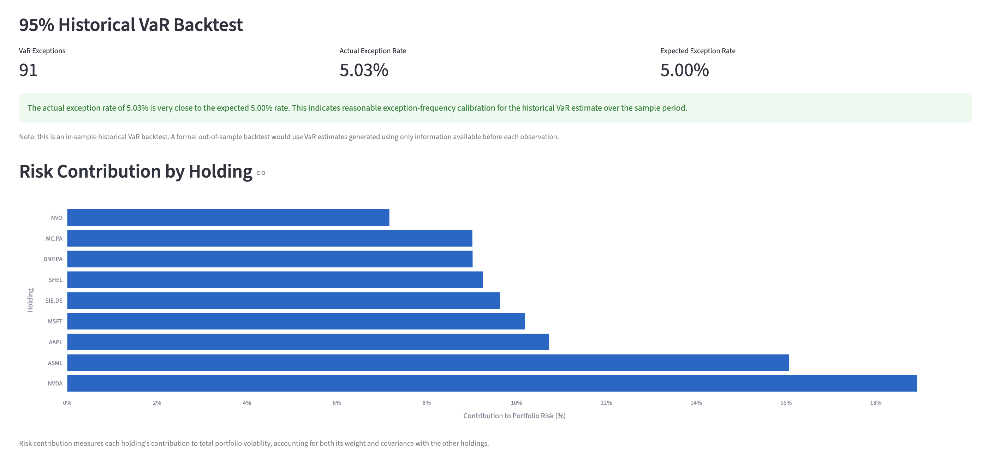
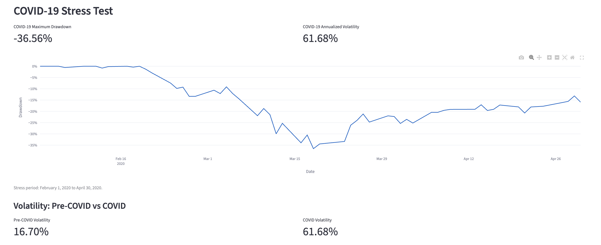
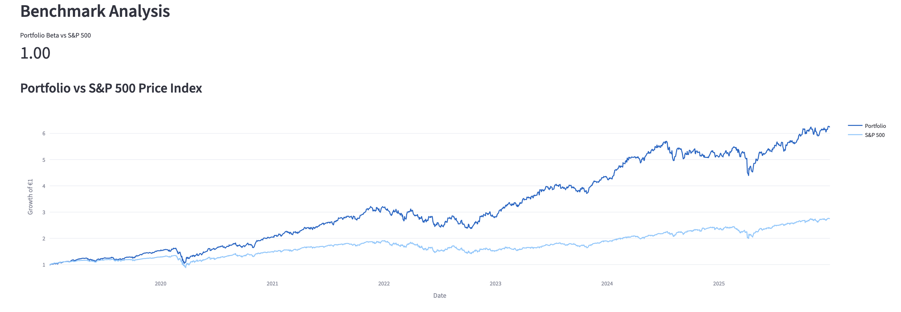

# Portfolio Risk & Performance Dashboard

A Python-based portfolio analytics project focused on portfolio performance measurement, market risk, diversification, historical stress testing, and benchmark analysis.

## 1. Project Objective

The objective of this project is to evaluate the performance and risk characteristics of a diversified equity portfolio using historical market data.

The project follows an institutional-style portfolio risk management workflow:

**Market Data → Portfolio Returns → Performance Measurement → Risk Analysis → VaR Backtesting → Stress Testing → Benchmark Analysis**

## 2. Portfolio Composition

The portfolio consists of nine large eurozone companies, equally weighted for the analysis. Every holding is listed and traded in **EUR**.

| Company | Ticker | Exchange | Sector |
|---|---|---|---|
| ASML Holding | ASML.AS | Euronext Amsterdam | Semiconductor equipment |
| BNP Paribas | BNP.PA | Euronext Paris | Banking |
| LVMH | MC.PA | Euronext Paris | Luxury goods |
| Siemens | SIE.DE | Xetra (Frankfurt) | Industrial technology |
| Airbus | AIR.PA | Euronext Paris | Aerospace |
| L'Oréal | OR.PA | Euronext Paris | Consumer goods |
| Sanofi | SAN.PA | Euronext Paris | Pharmaceuticals |
| SAP | SAP.DE | Xetra (Frankfurt) | Software |
| Allianz | ALV.DE | Xetra (Frankfurt) | Insurance |

The portfolio is analysed from the perspective of an **unhedged euro-based investor holding EUR-denominated equities**. Because all holdings and the benchmark are priced in EUR, returns contain no exchange-rate effect and no currency conversion is needed.

## 3. Key Analysis

### Portfolio Performance
- Daily asset and portfolio returns
- Annualized return and volatility
- Sharpe ratio
- Cumulative portfolio growth
- Maximum drawdown
- Rolling annualized volatility
- Best and worst trading days

### Market Risk
- Correlation analysis and covariance matrix
- Portfolio volatility
- Historical Value at Risk (VaR) at the 95% confidence level
- Conditional Value at Risk (CVaR / Expected Shortfall)
- Historical VaR backtesting
- Component Contribution to Risk (CCtR)

### Historical Stress Testing
- COVID-19 stress-period analysis
- Portfolio drawdown during the stress period
- Annualized volatility during the stress period
- Comparison with pre-COVID volatility

### Benchmark Analysis
- Comparison against the EURO STOXX 50 ETF (net return proxy, EUR)
- Portfolio beta
- Cumulative growth comparison
- Relative historical performance

## 4. Dashboard Highlights

The dashboard presents key portfolio performance and risk indicators, including annualized return, annualized volatility, Sharpe ratio, maximum drawdown, historical VaR, CVaR, and supporting visualizations.

The dashboard reports the following results for the portfolio's historical sample (2 January 2019 to 30 December 2025):

> **Note:** the results below and the dashboard screenshots will be updated after the notebooks have been run on the new EUR-denominated European portfolio. The screenshots currently show the previous version of the portfolio.

| Metric | Result |
|---|---:|
| Annualized return | To be updated |
| Annualized volatility | To be updated |
| Sharpe ratio | To be updated |
| Maximum drawdown | To be updated |
| 95% Historical VaR (1-day) | To be updated |
| 95% CVaR / Expected Shortfall | To be updated |

### VaR Backtesting

The 95% historical VaR backtest counts the days on which the portfolio's return was worse than the VaR threshold and compares this exception rate with the expected rate of 5%. Because the threshold is estimated from the same sample (an in-sample test), the exception rate is close to 5% by construction; it does not, by itself, establish that the VaR model is reliable under all market conditions.

*These are historical sample results, not forecasts or guarantees of future performance.*

### Dashboard Preview

#### 1. Portfolio Overview


#### 2. VaR Backtesting and Risk Contribution


#### 3. COVID-19 Stress Testing


#### 4. Benchmark Analysis


## 5. Methodology

- **Data.** Daily adjusted closing prices from Yahoo Finance (`yfinance`), 2 January 2019 to 30 December 2025. Adjusted prices reflect dividends (reinvested gross of withholding tax on the ex-dividend date) and stock splits. Notebook 1 shows the number of missing prices, the final date range and any remaining missing values, and plots the prices rebased to 100 as a visual check.
- **Base currency.** EUR. All holdings and the benchmark are priced in EUR, so no currency conversion is applied and returns have no exchange-rate component.
- **Dates and missing values.** The stocks and the benchmark are kept on their **common trading dates**: only dates on which all nine stocks and the benchmark have a price are used. Dates on which one exchange was closed (for example Xetra on 24 and 31 December) are removed, so the next daily return covers two days. No missing price is filled or estimated.
- The portfolio is constructed using equal weights across the nine holdings, applied to each day's returns (the portfolio is rebalanced to equal weights daily, with no transaction costs).
- Annualized return is the mean daily return × 252; annualized volatility is the daily standard deviation × √252.
- **Risk-free rate.** The Sharpe ratio uses a constant risk-free rate of 1.05% per year: a full-period approximation equal to the simple average of the annual €STR (euro short-term rate) averages for 2019–2025. €STR began on 2 October 2019, so the 2019 figure covers only October–December but counts as a full year in the average. Using the ECB's pre-€STR for January–September 2019 (estimated as EONIA minus the 8.5 basis-point spread published by the ECB) gives approximately 1.06% instead; the difference changes the Sharpe ratio by less than 0.001, so 1.05% is kept. Sharpe ratio = (annualized return − 1.05%) ÷ annualized volatility, which is equivalent to subtracting 1.05% ÷ 252 from every daily return.
- **Benchmark.** The Xtrackers EURO STOXX 50 UCITS ETF 1C (`XESC.DE`, Xetra, EUR), an accumulating fund that tracks the EURO STOXX 50 Net Return index. It is used as an investable proxy for the index and labelled "EURO STOXX 50 ETF (net return proxy, EUR)". All nine holdings are members of the EURO STOXX 50.
- Historical VaR estimates the loss threshold at the 95% confidence level; CVaR estimates the average loss beyond that threshold.
- VaR backtesting compares observed portfolio losses against the estimated VaR threshold.
- Component Contribution to Risk measures each holding's contribution to total portfolio volatility.
- Beta measures the portfolio's historical sensitivity to the benchmark's returns over aligned observations.

## 6. Technology Stack

- Python
- Pandas
- NumPy
- yfinance
- Streamlit
- Plotly
- Jupyter Notebook

## 7. Project Structure

```text
Portfolio_Risk_Dashboard/
├── data/
│   ├── adj_close.csv      # stock prices in EUR (created by Notebook 1)
│   └── benchmark.csv      # EURO STOXX 50 ETF benchmark prices in EUR (created by Notebook 1)
├── images/
├── notebooks/
│   ├── 01_Download_Data.ipynb
│   ├── 02_Portfolio_Returns.ipynb
│   └── 03_Risk_Analysis.ipynb
├── reports/
├── src/
│   ├── dashboard.py
│   ├── Open_Dashboard.command
│   └── pages/
├── README.md
└── requirements.txt
```

## 8. How to Run the Dashboard

1. Install Python and the packages listed in `requirements.txt`.
2. Run `notebooks/01_Download_Data.ipynb` to download the data and create the files in `data/`.
3. Open a terminal in the project's `src` directory.
4. Run:

   ```bash
   python -m streamlit run dashboard.py
   ```

5. Open the local URL displayed in the terminal, usually `http://localhost:8501`.

Keep the terminal session running while using the dashboard.

## 9. Limitations

- The analysis is based on historical market data; past performance does not predict future results.
- Historical VaR and CVaR depend on the selected sample and may not capture all extreme market events.
- The portfolio uses equal weights, and results depend on the portfolio construction and rebalancing assumptions implemented in the code.
- Benchmark fee and tracking difference: the benchmark is an ETF, not the index itself.
  - **Fee.** The fund charges 0.09% a year, deducted gradually from its value, so its return is lower than the index's by about that amount.
  - **Tracking difference.** The fund's return minus the index's return. Besides the fee, it reflects the withholding tax the fund actually pays on dividends, income from lending its shares, and trading costs, so it can be larger or smaller than the fee and varies from year to year.
  - **Gross versus net dividends.** The fund follows the **net** return index (dividends reinvested after withholding tax), whereas the stocks' adjusted prices reinvest dividends **gross**. Together with the fee, this means the benchmark's return is held back relative to the stocks, which slightly flatters the portfolio's relative performance. The size of this gap has not been measured in this project; it is plausibly in the region of half a percentage point a year, but this is an estimate, not an exact figure.
  - Volatility, correlation and beta are essentially unaffected, because a small, steady drag barely changes day-to-day return movements.
  - Yahoo Finance uses the fund's Xetra closing price, which can differ slightly from its official net asset value.
- Concentration: the portfolio holds nine stocks from three countries (France, Germany, the Netherlands), so its results are specific to these companies and to the eurozone large-cap market.
- Risk-free rate: the constant 1.05% is a full-period approximation of €STR, whose annual average ranged from about −0.57% to 3.64% over 2019–2025. The 2019 observation period is incomplete (October–December only); a full-year pre-€STR estimate gives approximately 1.06%.

## 10. Disclaimer

This project is for educational and analytical purposes only. It does not constitute investment advice or a recommendation to buy or sell securities.