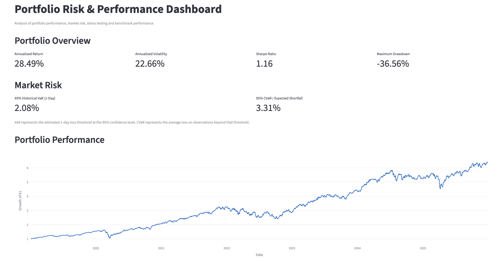
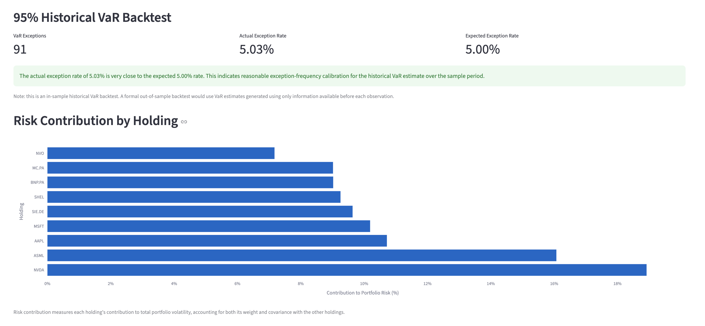
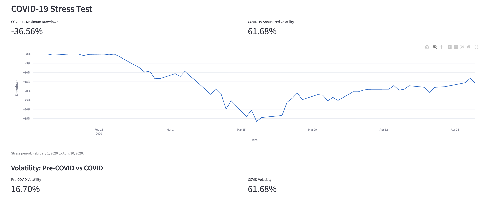
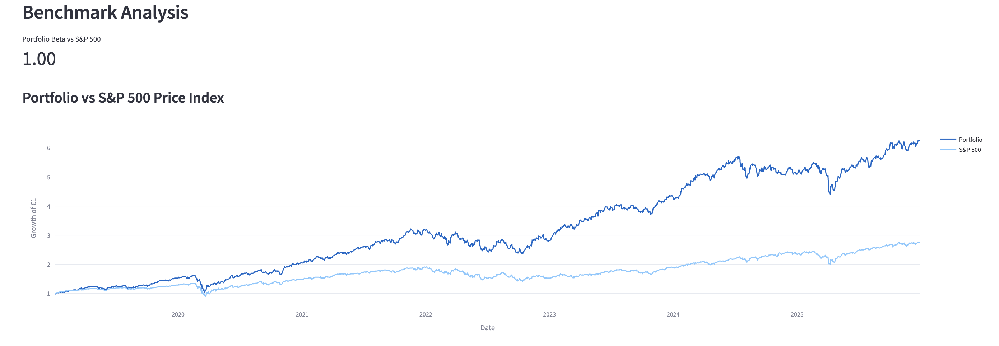

# Portfolio Risk & Performance Dashboard

A Python-based portfolio analytics project focused on portfolio performance measurement, market risk, diversification, historical stress testing, and benchmark analysis.

## 1. Project Objective

The objective of this project is to evaluate the performance and risk characteristics of a diversified equity portfolio using historical market data.

The project follows an institutional-style portfolio risk management workflow:

**Market Data → Portfolio Returns → Performance Measurement → Risk Analysis → VaR Backtesting → Stress Testing → Benchmark Analysis**

## 2. Portfolio Composition

The portfolio consists of nine US and European equities, equally weighted for the analysis.

| Company | Ticker |
|---|---|
| Apple | AAPL |
| ASML | ASML |
| BNP Paribas | BNP.PA |
| LVMH | MC.PA |
| Microsoft | MSFT |
| NVIDIA | NVDA |
| Novo Nordisk | NVO |
| Shell | SHEL |
| Siemens | SIE.DE |

## 3. Key Analysis

### Portfolio Performance
- Daily asset and portfolio returns
- Annualized return and volatility
- Sharpe ratio
- Cumulative portfolio growth
- Maximum drawdown
- Rolling annualized volatility
- Best and worst trading days

### Market Risk
- Correlation analysis and covariance matrix
- Portfolio volatility
- Historical Value at Risk (VaR) at the 95% confidence level
- Conditional Value at Risk (CVaR / Expected Shortfall)
- Historical VaR backtesting
- Component Contribution to Risk (CCtR)

### Historical Stress Testing
- COVID-19 stress-period analysis
- Portfolio drawdown during the stress period
- Annualized volatility during the stress period
- Comparison with pre-COVID volatility

### Benchmark Analysis
- Comparison against the S&P 500
- Portfolio beta
- Cumulative growth comparison
- Relative historical performance

## 4. Dashboard Highlights

The dashboard presents key portfolio performance and risk indicators, including annualized return, annualized volatility, Sharpe ratio, maximum drawdown, historical VaR, CVaR, and supporting visualizations.

The current dashboard reports the following results for the portfolio's historical sample:

| Metric | Result |
|---|---:|
| Annualized return | 28.49% |
| Annualized volatility | 22.66% |
| Sharpe ratio | 1.16 |
| Maximum drawdown | -36.56% |
| 95% Historical VaR (1-day) | 2.08% |
| 95% CVaR / Expected Shortfall | 3.31% |

### VaR Backtesting

The historical 95% VaR backtest recorded 91 exceptions, corresponding to an observed exception rate of 5.03%, compared with the expected rate of 5.00%. This indicates that the observed exception frequency was close to the nominal rate over the historical sample. It does not, by itself, establish that the VaR model is reliable under all market conditions.

*These are historical sample results, not forecasts or guarantees of future performance.*

### Dashboard Preview

#### 1. Portfolio Overview


#### 2. VaR Backtesting and Risk Contribution


#### 3. COVID-19 Stress Testing


#### 4. Benchmark Analysis


## 5. Methodology

- Historical adjusted closing prices are used to calculate daily asset returns.
- The portfolio is constructed using equal weights across the nine holdings.
- Annualized volatility is calculated using daily return volatility and 252 trading days.
- The Sharpe ratio uses a 2.25% annual risk-free rate.
- Historical VaR estimates the loss threshold at the 95% confidence level; CVaR estimates the average loss beyond that threshold.
- VaR backtesting compares observed portfolio losses against the estimated VaR threshold.
- Component Contribution to Risk measures each holding's contribution to total portfolio volatility.
- Beta measures the portfolio's historical sensitivity to S&P 500 returns over aligned observations.

## 6. Technology Stack

- Python
- Pandas
- NumPy
- yfinance
- Streamlit
- Plotly
- Jupyter Notebook

## 7. Project Structure

```text
Portfolio_Risk_Dashboard/
├── data/
│   └── adj_close.csv
├── images/
├── notebooks/
│   ├── 01_Download_Data.ipynb
│   ├── 02_Portfolio_Returns.ipynb
│   └── 03_Risk_Analysis.ipynb
├── reports/
├── src/
│   ├── dashboard.py
│   ├── Open_Dashboard.command
│   └── pages/
├── README.md
└── requirements.txt
```

## 8. How to Run the Dashboard

1. Install Python and the packages listed in `requirements.txt`.
2. Open a terminal in the project's `src` directory.
3. Run:

   ```bash
   python -m streamlit run dashboard.py
   ```

4. Open the local URL displayed in the terminal, usually `http://localhost:8501`.

Keep the terminal session running while using the dashboard.

## 9. Limitations

- The analysis is based on historical market data; past performance does not predict future results.
- Historical VaR and CVaR depend on the selected sample and may not capture all extreme market events.
- The portfolio uses equal weights, and results depend on the portfolio construction and rebalancing assumptions implemented in the code.
- Benchmark comparisons depend on the selected S&P 500 data series and its return methodology.

## 10. Disclaimer

This project is for educational and analytical purposes only. It does not constitute investment advice or a recommendation to buy or sell securities.